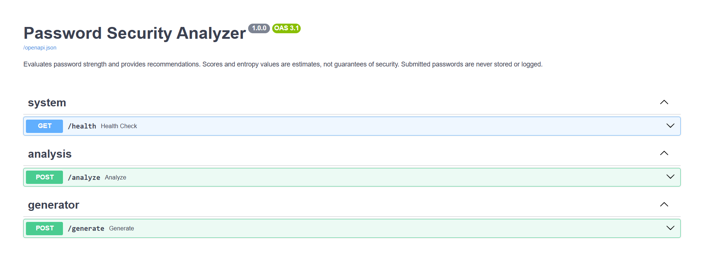
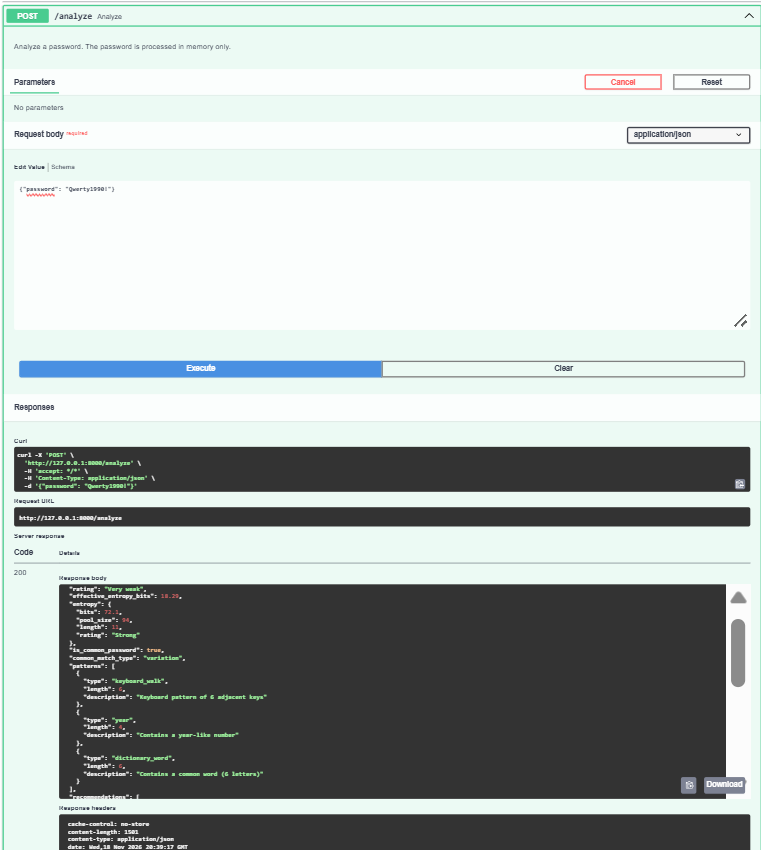
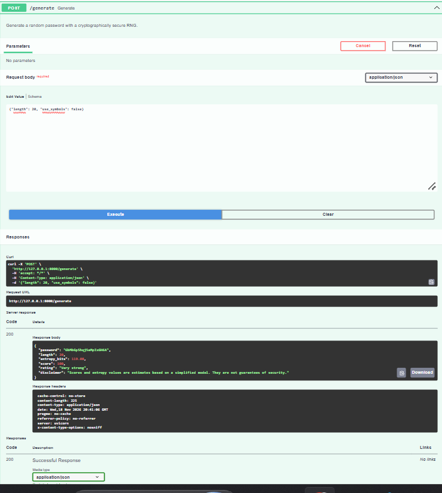

# Password Security Analyzer

A simple REST API built with Python and FastAPI that checks how strong a password is, explains its weaknesses, and generates secure passwords.

Passwords are analyzed in memory only. They are never stored or logged.

## Features

- Password strength score (0 to 100)
- Entropy estimation (in bits)
- Detection of common passwords (including variations like `p@ssw0rd`)
- Detection of patterns: repeated characters, sequences (`abcd`, `1234`), keyboard patterns (`qwerty`, `azerty`), years and common words
- Personalized recommendations to improve a password
- Secure random password generator

## Tech Stack

- Python
- FastAPI
- Pydantic
- Uvicorn
- Pytest

## Installation

```bash
git clone https://github.com/maissounghedir/password-security-analyzer.git
cd password-security-analyzer

python -m venv .venv
source .venv/bin/activate

pip install -r requirements.txt
```

On Windows, activate the environment with:

```powershell
.venv\Scripts\activate
```

## Run

```bash
python -m uvicorn app.main:app --reload
```

Then open http://127.0.0.1:8000/docs to try the API in your browser.

## API

| Method | Endpoint | Description |
|---|---|---|
| GET | `/health` | Check that the API is running |
| POST | `/analyze` | Analyze a password |
| POST | `/generate` | Generate a secure password |

### Example: Analyze a password

```bash
curl -X POST http://127.0.0.1:8000/analyze \
  -H "Content-Type: application/json" \
  -d '{"password": "Qwerty1990!"}'
```

The response contains the score, the entropy, the detected weaknesses and recommendations.

### Example: Generate a password

```bash
curl -X POST http://127.0.0.1:8000/generate \
  -H "Content-Type: application/json" \
  -d '{"length": 20}'
```

## Screenshots







## Security

- Passwords are never stored, logged or returned in responses.
- Passwords are sent in the request body, never in the URL.
- Random passwords use Python's `secrets` module (cryptographically secure).
- Requests are validated, rate-limited and size-limited.

Scores and entropy values are estimates, not guarantees of security. Use this tool locally and always deploy it behind HTTPS.

## Tests

```bash
pytest -v
```

## License

MIT. See the [LICENSE](LICENSE) file.

## Author

Ghedir Maissoun
